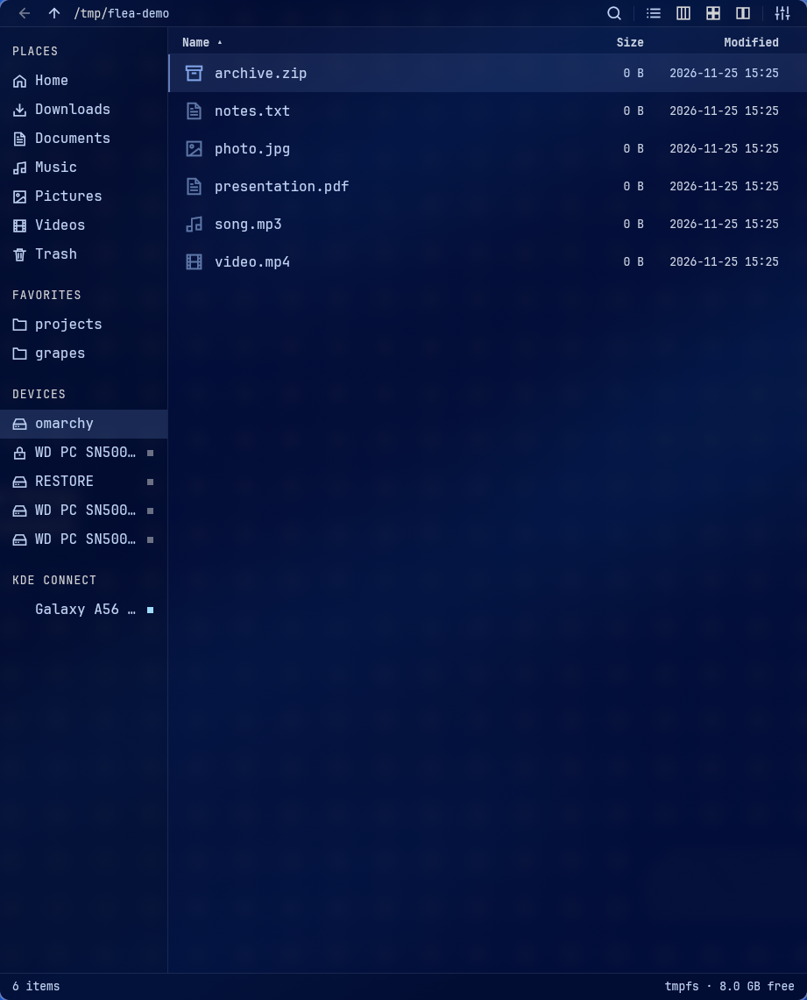

# flea-kdeconnect

Browse your paired phone from the [Flea](https://github.com/thisisgm/flea) rail
and send files to it with [KDE Connect](https://kdeconnect.kde.org/) — the
Dolphin-style phone integration, for people who switched to Flea.



## What you get

- **A rail row per paired device.** Every paired and reachable KDE Connect
  device appears under a `KDE CONNECT` rail heading (refreshed every ~15 s).
  Activating the row mounts the phone's storage over SFTP and opens it as a
  normal local folder — copy and paste in both directions, no extra windows.
- **Send to phone.** A file-menu action that pushes the selected files and
  folders to your phone (folders are zipped, up to 512 items at once).
- **Self-healing.** The share is re-mounted on every refresh, so it recovers
  from idle timeouts and reconnects on its own.

## Requirements

- Flea 0.4.x
- KDE Connect (`kdeconnectd`, `kdeconnect-cli`) and `busctl` (ships with
  systemd). On Arch: `sudo pacman -S kdeconnect`
- A paired device with the KDE Connect app, reachable on your LAN
  - Android: pair in the KDE Connect app and keep its **SFTP** (filesystem
    exposure) plugin enabled
- Ports 1714–1764 TCP/UDP open on both ends (KDE Connect's range)

## Install

```sh
flea plugin add https://github.com/im6ix/flea-kdeconnect
flea plugin enable io.github.im6ix.flea-kdeconnect
```

Restart Flea if it was already running. Update later with
`flea plugin update io.github.im6ix.flea-kdeconnect`.

## How it works

No daemons of its own — the plugin only talks to the stock KDE Connect daemon:

- On every refresh it lists paired, reachable devices with
  `kdeconnect-cli --list-available` and mounts each through the daemon's SFTP
  DBus interface (`busctl --user call org.kde.kdeconnect
  /modules/kdeconnect/devices/<id>/sftp org.kde.kdeconnect.device.sftp
  mountAndWait`). KDE Connect performs the actual sshfs mount under
  `/run/user/<uid>/<device-id>/`.
- The rail row opens that mount as a plain folder, so all of Flea's normal
  file operations work untouched.
- Send to phone uses `kdeconnect-cli --device <id> --share …` with an argument
  list only — no shell involved.

The plugin is a single Python 3 file using only the standard library.

## Troubleshooting

- **No row appears**: check that the device is paired and reachable
  (`kdeconnect-cli -l`), that both are on the same network, and that Flea was
  restarted after enabling the plugin.
- **Row is greyed out**: the device is reachable but its SFTP mount failed.
  If the phone shows a filesystem-access prompt, accept it, and make sure the
  SFTP plugin is enabled in the KDE Connect app.
- **Transfers fail**: open ports 1714–1764 TCP/UDP on the firewall.

## Development

```sh
python3 -m unittest test_plugin -v   # stdlib only, no phone or Flea needed
flea plugin validate .
```

## License

[MIT](LICENSE)
